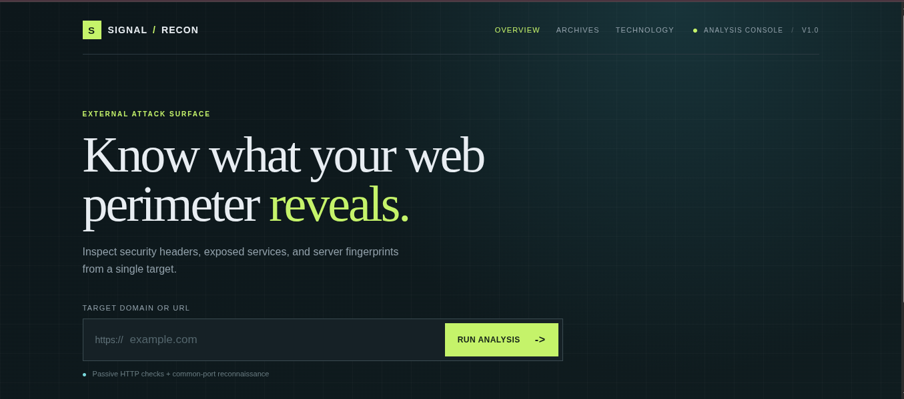

# SOC Web Recon & Hardening Dashboard

A lightweight, FastAPI-powered reconnaissance and security hardening dashboard for web application assessment. It combines passive and active checks to help security teams quickly review headers, exposed paths, infrastructure details, and likely technology stacks before recommending remediation.

---

## What’s New and Improved

This project has evolved beyond a basic header scanner into a more complete reconnaissance toolkit. Recent additions include:

- Passive subdomain enumeration via Certificate Transparency sources
- Directory and content discovery for common sensitive endpoints and backup/config paths
- JavaScript and API endpoint extraction with credential masking
- Internet Archive URL harvesting for historical exposure checks
- Technology fingerprinting for frameworks, CMS platforms, hosting/CDN tech, and server clues
- Stronger header validation with weak/absent/misconfigured detection and remediation guidance
- Concurrent scan execution for improved speed and better resilience to slow targets
- Ranked scan summaries with confidence signals and result classification
- Multi-page reporting with overview, archive, and technology views
- Browser-based JSON export and print/PDF reporting
- Built-in security guidance and project policy notes for ethical and responsible use

---

## Core Features

- Security header auditing for common protections such as `Content-Security-Policy`, `Strict-Transport-Security`, `X-Frame-Options`, `X-Content-Type-Options`, `Referrer-Policy`, and `Permissions-Policy`
- Banner and technology disclosure analysis using headers, cookies, and HTML patterns
- Port reconnaissance and service checks with `nmap`
- Passive subdomain discovery using public certificate data and DNS validation
- Directory discovery against a controlled set of common admin, backup, and config paths
- JavaScript and API analysis to find likely app endpoints and potentially sensitive client-side tokens
- Archived URL retrieval from the Internet Archive for historical discovery and footprinting
- Ranked risk summaries that separate verified findings from weak or unverified results
- Nginx hardening snippet generation for missing or weak security controls
- Multi-page frontend with shared detail views and saved local scan state

---

## Tech Stack

- Backend: Python 3.12, FastAPI, Uvicorn, Requests, Pydantic
- Recon tooling: `python-nmap`, DNS checks, HTTP session handling with bounded retries
- Frontend: Vanilla JavaScript, HTML5, CSS3 with dark mode and print-friendly styling
- Data sources: `crt.sh` certificate transparency, Internet Archive CDX API, live HTTP responses
- System dependency: `nmap` for network reconnaissance

---

## Project Structure

```text
scanner/
├── app.py
├── requirements.txt
├── README.md
├── SECURITY.md
├── UPDATES.md
├── core/
│   ├── archive_harvester.py
│   ├── directory_discovery.py
│   ├── header_checker.py
│   ├── http_client.py
│   ├── js_api_analysis.py
│   ├── port_scanner.py
│   ├── result_scoring.py
│   ├── subdomain_enumerator.py
│   ├── technology_fingerprint.py
│   └── __init__.py
├── routers/
│   ├── __init__.py
│   └── scan.py
└── static/
    ├── app.js
    ├── archives.html
    ├── detail.js
    ├── index.html
    ├── style.css
    └── technologies.html
```

---

## Installation & Local Setup

### 1. Prerequisites

Ensure `nmap` is installed on your Linux, macOS, or Windows system:

```bash
sudo apt install nmap -y

brew install nmap

winget install Insecure.Nmap
```

### 2. Create a virtual environment

```bash
python3 -m venv venv
source venv/bin/activate  # Linux/macOS
# venv\Scripts\activate  # Windows
```

### 3. Install dependencies

```bash
pip install -r requirements.txt
```

### 4. Run the app

```bash
uvicorn app:app --reload
```

Then open the dashboard in your browser at:

```text
http://127.0.0.1:8000
```

---

## API Usage

The scan API exposes a single endpoint for reconnaissance requests:

```bash
curl -X POST "http://127.0.0.1:8000/api/scan" \
  -H "Content-Type: application/json" \
  -d '{"url":"example.com"}'
```

This returns structured results for:

- response headers
- open ports
- subdomains
- directory findings
- JavaScript/API findings
- archive records
- technology fingerprints
- final summary with confidence scoring

---

## Responsible Use

This project is intended for authorized security testing and legitimate reconnaissance workflows only. Do not run scans against systems without explicit permission. This includes avoiding abuse of public data sources and respecting rate limits, service policies, and privacy expectations.

---

## Notes

- The project is built as a practical SOC-style demo and security assessment utility.
- Several modules are optimized for fast reporting and clarity, while still preserving structured raw data for export.
- The project continues to evolve with additional reconnaissance, scoring, and reporting improvements.

Here's a UI image of Recon Dashboard


